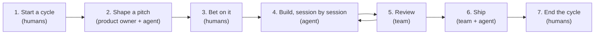

# ShapeUp for Claude Code

A Claude Code plugin for running [Shape Up](https://basecamp.com/shapeup) with AI agents. Product owners shape pitches
with an agent and decide what ships. Agents build the bets autonomously, one focused session at a time, and keep
everything they do in your tracker: GitHub Issues or Azure DevOps Boards.

> **Status:** experimental. The flow works end to end, but expect rough edges and changes between versions.

## What is Shape Up?

Shape Up is the product development method [Basecamp](https://basecamp.com) (now [37signals](https://37signals.com))
developed for their own teams. Ryan Singer describes it in the book
[*Shape Up: Stop Running in Circles and Ship Work that Matters*](https://basecamp.com/shapeup), which you can read for
free online. In short:

- **Shaping:** before work is handed to a team, it is shaped into a **pitch**: the problem, a rough solution, the
  rabbit holes to avoid and what is out of scope ([chapters 2–6](https://basecamp.com/shapeup/1.1-chapter-02)).
- **Appetite:** instead of estimating, you decide how much time an idea is worth, and fit the solution to that budget
  ([setting the appetite](https://basecamp.com/shapeup/1.2-chapter-03#setting-the-appetite)).
- **Betting:** at the [betting table](https://basecamp.com/shapeup/2.2-chapter-08), the people in charge pick which
  pitches to bet on for the next **cycle**.
- **Building:** the team owns the bet, discovers the real work as **scopes**, and shows progress on a
  [hill chart](https://basecamp.com/shapeup/3.4-chapter-13): uphill while figuring things out, downhill when only
  execution is left.
- **Circuit breaker:** if a bet isn't done when its time runs out, it doesn't get extended by default
  ([the circuit breaker](https://basecamp.com/shapeup/2.2-chapter-08#the-circuit-breaker)).

The [glossary](https://basecamp.com/shapeup/4.5-appendix-06) is a good one-page summary. This plugin is an independent
interpretation and is not affiliated with or endorsed by Basecamp or 37signals.

## How the plugin applies it

| Shape Up | In this plugin |
|---|---|
| Pitch | Shaped with the `shapeup:shape` skill, section by section, and posted as a **bet** in the tracker. |
| Appetite | A number of agent **sessions**, not weeks. It is a budget, never an estimate. |
| Cycle | A GitHub milestone, or an Azure DevOps Epic. Humans create and close them. |
| Betting table | Humans decide which pitches become bets in a cycle. The plugin never picks one. |
| Scopes | **Slices**: sub-issues or User Stories the building agent discovers and names itself. |
| Hill chart | Each slice is tagged `uphill` or `downhill`, with a comment whenever it moves. |
| Questions to the shaper | **Questions**: sub-issues or Tasks assigned to the shaper, each with the agent's default answer. |
| Circuit breaker | When the sessions run out before the bet is finished, the agent posts `CIRCUIT BREAKER` and stops. |
| Cool-down | Work the agent notices but the bet doesn't need is listed under `Outside this bet:`, not done. |

## Requirements

- [Claude Code](https://code.claude.com).
- **GitHub:** the [GitHub CLI](https://cli.github.com) (`gh`), signed in.
- **Azure DevOps:** Node.js 20 or later for the [Azure DevOps MCP server](https://github.com/microsoft/azure-devops-mcp),
  and `git push` to Azure Repos working without a prompt (for example with Git Credential Manager).
- A **Definition of done** in your repository's `CLAUDE.md`. `/shapeup:init` helps you write one.

## Install

```bash
claude plugin marketplace add kjelli/shapeup-plugin
claude plugin install shapeup@shapeup-plugin
```

Or, inside a session: `/plugin marketplace add kjelli/shapeup-plugin`, then `/plugin install shapeup@shapeup-plugin`.

To have everyone who clones a project offered the plugin, commit this to the project's `.claude/settings.json`:

```json
{
  "extraKnownMarketplaces": {
    "shapeup-plugin": {
      "source": { "source": "github", "repo": "kjelli/shapeup-plugin" }
    }
  },
  "enabledPlugins": {
    "shapeup@shapeup-plugin": true
  }
}
```

## Set up a project

In the repository, run:

```
/shapeup:init
```

It asks which tracker and code host you use, connects to them, checks access and repository settings, creates the
labels it needs, helps you write a Definition of done, and saves where things live in `.claude/shapeup.json`. Commit
that file. Run `/shapeup:init` again at any time to check the setup.

### Which GitHub account the agent uses

GitHub never lets anyone approve a pull request opened under their own account, so `init` asks which account the
building agent should act as:

- **Your own account:** teammates approve the agent's pull requests with a normal review, or you merge them yourself.
- **A separate account for the agent** (a machine account with write access): anyone, you included, can approve with
  a normal review. Sign it in once, then switch back to yourself:

  ```bash
  gh auth login                       # sign in as the agent's account
  gh auth switch --user <your login>
  ```

  gh keeps both. You stay the active account; the agent uses its own token, git identity and push credentials for its
  commands only, through the plugin's `as-github-agent` wrapper. Your own setup isn't touched. Use an HTTPS remote so
  pushes can use the agent's token.

Shaping always runs as you, so bets are created and assigned by the product owner.

The repository needs issues turned on, merge commits and squash merges both allowed, *Automatically delete head
branches* turned off, and at least one open milestone. `init` checks all of this. It also recommends
[rulesets](https://docs.github.com/repositories/configuring-branches-and-merges-in-your-repository/managing-rulesets/about-rulesets)
that allow only merge commits into `bet/**` branches and only squash merges into the main branch, so a manual merge
can't pick the wrong type.

## Usage



1. **Start a cycle.** Create a milestone on GitHub, or an Epic in the area path on Azure DevOps, for example
   `Cycle 1`.
2. **Shape a pitch.** In a new conversation, say `Help me shape a pitch` (or `/shapeup:shape <title>`). The agent walks
   you through the title, appetite, problem, solution, rabbit holes and no-gos, suggesting a draft for each. You
   decide every word, and the appetite is yours alone: the agent never suggests or negotiates it.
3. **Bet on it.** When you confirm, the agent posts the pitch as a bet in the cycle you choose. Deciding which pitches
   get a cycle is the team's betting table, not the agent's.
4. **Build.** Start a **new** conversation and say `Continue with bet #12`, or name it: `Continue with Survives a
   restart` (or `/shapeup:build <id or name>`). The agent reads the bet and everything recorded on it, works for one
   focused session (finding slices, writing code and tests, opening pull requests), records what it did on the
   bet, and stops. Repeat with a new conversation for every session. The tracker, not the conversation, is the
   agent's memory.
5. **Review** between sessions:
   - **Questions:** answer the question issues assigned to you. Unanswered ones get the agent's proposed default in
     its next session, recorded as a decision.
   - **Pull requests:** approve to let the agent merge in its next session, or leave comments to send work back.
   - **Decisions:** read the `DECISION` comments to see every judgment call the agent made on its own.
6. **Ship.** When every slice is merged or cut, the agent opens one pull request from the bet branch to the main
   branch and marks the bet resolved. Approve it and run one more session: the agent squash-merges it and comments that
   the bet shipped. Then close the bet.
7. **End the cycle.** Close the cycle and any remaining bets. Read the `CIRCUIT BREAKER` comments on bets that ran out
   of sessions and decide whether to shape them again. The `Outside this bet:` notes are candidates for cool-down.

### Ground rules

- **Shape and build in separate conversations**, and don't change a pitch once it is being built: answer the
  agent's questions instead.
- **One session per bet at a time.** Several bets can be built in parallel. `Session N of M started` and `ended`
  comments act as a lock.
- **Don't edit the agent's issues by hand.** Say what's wrong in a comment or a review, and the agent fixes it.
- **Avoid betting on overlapping parts of the product in the same cycle.** Two bets changing the same code will
  conflict.
- **Humans approve, agents merge.** The agent never approves its own work and merges only what a teammate approved.

### When the agent stops

| It says | What to do |
|---|---|
| The configuration is missing, or the tools aren't connected | Run `/shapeup:init`. |
| Several bets match the name, or none | Pick one from its list, or give the ID. |
| The bet is a technical task, not a pitch | Shape it again around the outcome people will notice. |
| Another session may be running | Make sure nobody else is running it, then tell the agent to take over. |
| The appetite is spent | Read the `CIRCUIT BREAKER` comment and decide what happens to the bet. |
| The bet is waiting for review | Approve or comment on the bet pull request, then run another session. |
| Blocked on unanswered questions | Answer the open questions. |

## Where things live

| | GitHub | Azure DevOps |
|---|---|---|
| Cycle | Milestone | Epic |
| Bet | Issue labelled `bet`, in the milestone | Feature under the Epic |
| Slice | Sub-issue of the bet, labelled `slice` | User Story under the Feature |
| Question | Sub-issue labelled `question` | Task |
| States | Open/closed plus `status:active` / `status:resolved` labels | Work item states |
| Branches | `bet/<id>` per bet, `slice/<id>-<name>` per slice | The same |

Nothing about cycles or bets is stored in the repository, so any number of people and agents can work at the same
time. `.claude/shapeup.json` only says where things live; see
[the configuration reference](plugins/shapeup/references/config.md).

## Updating

```bash
claude plugin marketplace update shapeup-plugin
claude plugin update shapeup@shapeup-plugin
```

Then start a new session, or run `/reload-plugins`. To update automatically, open `/plugin`, go to **Marketplaces**,
select `shapeup-plugin` and choose **Enable auto-update**.

## Adding a tracker or code host

The skills only speak in Shape Up terms. Everything specific to one tool lives in an adapter file that meets a
contract:

- Trackers: [contract](plugins/shapeup/references/tracker-contract.md), adapters in
  [`references/trackers/`](plugins/shapeup/references/trackers/).
- Code hosts: [contract](plugins/shapeup/references/code-host-contract.md), adapters in
  [`references/code-hosts/`](plugins/shapeup/references/code-hosts/).

The tracker and code host are chosen separately, so Azure DevOps Boards with code on GitHub works too. Jira or Trello
would need one new adapter file each. Contributions are welcome.

## Develop

Validate after every change, and bump `version` in `plugins/shapeup/.claude-plugin/plugin.json` when you release, or
installed copies won't update:

```bash
claude plugin validate .
claude plugin validate ./plugins/shapeup
```

To try local changes in a project without publishing, add this folder as a marketplace
(`claude plugin marketplace add ../shapeup-plugin`); edits then load at the next session start or with
`/reload-plugins`.

## License

[MIT](LICENSE). Shape Up and the book are © 37signals LLC; this plugin only refers to them.
